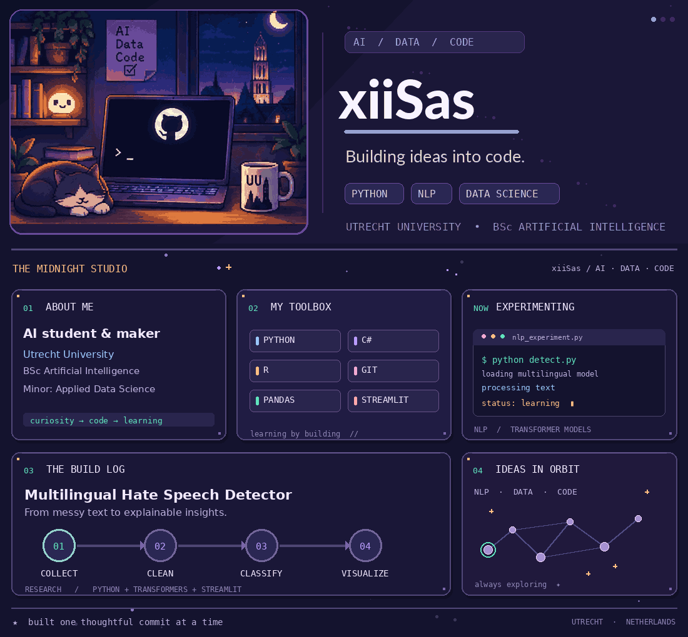

  

  ☾ A tiny midnight workspace for curious ideas, code and things I'm learning.

<b>✦ Open the studio notes</b> · About me, projects and tools

### Hey! I'm xiiSas 👋

I'm studying **Artificial Intelligence at Utrecht University** and pursuing a minor in **Applied Data Science**. I enjoy building practical applications and learning how machine learning, data analysis and software engineering work together.

### 🔭 What I'm exploring

- **Natural language processing:** multilingual classification and transformer models
- **Data science:** Python, pandas, and R
- **Software development:** building applications, writing readable code, and improving my engineering skills

### 🧪 Featured work

**Multilingual Hate Speech Detector** — Exploring hate speech classification across languages using multilingual and language-specific models, and building an interface with Streamlit.

*I share more projects and documentation as I develop them.*

  <a href="https://github.com/xiiSas?tab=repositories">Explore my repositories</a>
  &nbsp;·&nbsp;
  <a href="https://github.com/xiiSas">Visit my GitHub profile</a>

